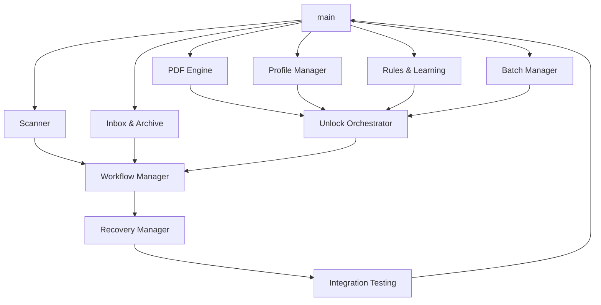

# PDF Unlocker — Module and Branch Architecture

**Document type:** Development architecture proposal  
**Repository:** `ag3ntfury/pdfunlocker`  
**Reference branch inspected:** `feature/unlock-orchestrator`  
**Status:** Proposed — approve before creating additional branches

## 1. Purpose

This document proposes a Git branch structure for developing PDF Unlocker by functional module. Each module can be improved and tested independently, while stable, tested changes are merged into `main`. Feature branches remain alive after merging and can continue receiving improvements.

The repository's `main` branch was observed to have an older, smaller source tree than `feature/unlock-orchestrator`. The module inventory below is therefore based primarily on the newer feature branch and the source tree inspected there.

## 2. Modules identified in the repository

| Module | Existing source files | Responsibility |
|---|---|---|
| Installer & Setup | `src/pdfunlocker/cli/main.py`, `src/pdfunlocker/setup/scan_locations.py` | Installation, setup wizard, environment detection |
| Configuration & Paths | `src/pdfunlocker/config/paths.py` | Directory structure, path validation and configuration paths |
| Profile Manager | `src/pdfunlocker/profiles/store.py`, `src/pdfunlocker/cli/profiles.py` | Profile creation, editing, ordering, validation and storage |
| Rules & Learning | `src/pdfunlocker/learning/candidates.py`, `ranking.py`, `tracker.py` | Candidate generation, rule ranking, attempt tracking and learning |
| Scanner | `src/pdfunlocker/scanner.py` | PDF discovery, hashing and duplicate detection |
| Inbox Manager | `src/pdfunlocker/inbox.py` | Import, validation and processing eligibility |
| Archive Manager | `src/pdfunlocker/archive.py` | Original archive and safe file publication |
| PDF Engine | `src/pdfunlocker/unlocker/engine.py`, `qpdf.py` | Decryption, verification and individual rule execution |
| Batch & Job Manager | `src/pdfunlocker/learning/batch_manager.py`, `database.py` | Batch assignments, processing state and document ownership |
| Database & Backup | `src/pdfunlocker/database/backup.py` | Database snapshots, exports and migration |
| CLI | `src/pdfunlocker/cli/main.py`, `profiles.py` | User-facing commands |
| Workflow Manager | No dedicated complete module yet | Coordinates the overall processing lifecycle |
| Unlock Orchestrator | Not yet implemented as a dedicated orchestrator | Sequential profiles, rules and fallback handling |
| Recovery Manager | No dedicated module identified yet | Interrupted jobs, resume, retry and reconciliation |

These are logical module boundaries. Some responsibilities currently share files, and the inventory does not imply that every module already has a fully independent implementation.

## 3. Proposed branch structure

### Stable branch

- `main` — production-ready, tested application code only.

### Functional feature branches

| Proposed branch | Scope |
|---|---|
| `feature/installer-setup` | Installation, setup wizard, upgrade and migration safety |
| `feature/configuration` | Paths, settings, environment detection and directory validation |
| `feature/profile-manager` | Profile storage, field validation, profile priority and profile CLI |
| `feature/rules-learning` | Rule YAML validation, candidate generation, ranking and learning |
| `feature/scanner` | Recursive scanning, exclusions, hashing and duplicate detection |
| `feature/inbox-archive` | Inbox handling, immutable original archive and safe output publication |
| `feature/pdf-engine` | QPDF adapter, decryption, error classification and output verification |
| `feature/batch-manager` | Batch assignments, job state, ownership and persistence |
| `feature/unlock-orchestrator` | Sequential profiles, rule sequencing, fallback and global attempt-rate enforcement |
| `feature/workflow-manager` | Integration of scanner, archive, inbox, unlocking and result handling |
| `feature/recovery-manager` | Resume, retry and interrupted-job recovery |
| `feature/database-backup` | Database integrity, schema migration, snapshots and exports |

### Optional integration branch

- `develop` — optional integration branch for combining tested module work before merging into `main`.

Do not create every branch immediately. Create a branch when work on that module is ready to begin. This avoids unnecessary branch maintenance and reduces merge conflicts.

## 4. Module responsibilities

### Installer & Setup
- Installation reliability and setup stages.
- Operating-system and environment detection.
- Upgrade and migration safeguards.
- Setup completion and regression behavior.

### Configuration & Paths
- Android and Linux path handling.
- Runtime settings and defaults.
- Directory creation and path relationship validation.
- Safe configuration updates.

### Profile Manager
- Profile creation, editing and deletion safeguards.
- Field validation and multiple values.
- Enabled/disabled status and execution order.
- Profile persistence and CLI behavior.

### Rules & Learning
- Rule-file schema and validation.
- Candidate generation and limits.
- Candidate fingerprinting without persisting plaintext passwords.
- Rule statistics, ranking and learning policy.

### Scanner
- Recursive PDF discovery.
- Configured scan locations and exclusions.
- SHA-256 identity and duplicate detection.
- Symlink and unreadable-file handling.
- Never modify original scan-location files.

### Inbox & Archive
- Safe import and inbox state.
- Immutable original archive.
- Verified file copying and publication.
- Destination collision handling and interrupted file-operation recovery.

### PDF Engine
- QPDF integration.
- Single-rule execution.
- Password-safe handling.
- Decryption and output verification.
- Structured result and error classification.

### Batch & Job Manager
- Batch assignment and sequencing.
- Processing state transitions.
- Document ownership.
- Persistent job history and duplicate-assignment prevention.

### Unlock Orchestrator
- Automatic loading of enabled profiles.
- Sequential profile execution in configured order.
- Rule ordering within each profile.
- Move to the next profile only when the previous profile has exhausted its applicable rules and the document remains locked.
- Stop immediately after verified successful decryption.
- Enforce a global maximum of 50 candidate attempts per second across the complete orchestration process.
- Exclude reserved rule `00000` except in explicit test mode.
- Do not persist or log plaintext candidate passwords.

### Workflow Manager
- Coordinate the complete processing lifecycle.
- Invoke modules in the correct order.
- Enforce state transitions and processing safeguards.
- Coordinate normal, retry and recovery workflows.
- Avoid duplicating scanner, archive or unlocking business logic.

### Recovery Manager
- Detect interrupted and incomplete jobs.
- Resume or safely retry eligible work.
- Reconcile database state with files on disk.
- Prevent duplicate processing and accidental overwrite after restart.

### Database & Backup
- Database integrity checks.
- Versioned schema migrations.
- Consistent SQLite snapshots.
- User-requested exports and private recovery backups.

## 5. Module dependencies

The following is a logical dependency map, not an instruction to merge branches automatically:

The Workflow Manager integrates the functional modules. The Unlock Orchestrator coordinates profile and rule execution. These are related but distinct responsibilities.

## 6. Branch development and merge policy

1. `main` contains production-ready, tested code only.
2. Do not develop directly on `main`.
3. Develop module-specific changes on the corresponding feature branch.
4. Run the module's unit and integration tests.
5. Run the full regression suite before merging.
6. Merge only reviewed and tested changes into `main` (or into `develop` first if that integration branch is adopted).
7. Keep feature branches after merging; do not delete them.
8. Before further development, synchronize the feature branch with the latest stable `main` and resolve conflicts deliberately.
9. Avoid force-pushing shared branches.
10. Use Git tags for stable releases, for example `v1.0.0` and `v1.1.0`.

Feature branches are long-lived work streams, not permanent forks of the application. Their changes should periodically be integrated with the stable branch.

## 7. Testing levels

- **Module tests:** Verify each module independently.
- **Integration tests:** Verify interfaces and behavior between connected modules.
- **Full regression tests:** Verify that new work does not break existing functionality.

All tests must use isolated temporary directories and databases. Tests must not depend on or modify the developer's live PDF library or personal profile data.

For unlocking work, use synthetic PDFs first. Do not run real unlocking on personal documents until orchestration is implemented, thoroughly tested and separately approved.

## 8. Database and shared-interface coordination

Some modules share SQLite tables and public interfaces. Schema changes must be coordinated and versioned rather than independently invented on multiple branches.

Before changing a shared interface:
- Identify every caller and test.
- Document the intended contract.
- Add compatibility tests.
- Coordinate dependent branches.
- Run the full test suite after integration.

## 9. Current branch status

At the time this proposal was prepared:

- `feature/workflow-manager` exists.
- `feature/unlock-orchestrator` exists and was pushed to origin.
- Both branches were reported at commit `19a88fb`.
- Additional module branches are proposals only and have not been created by this document.

## 10. Recommended next steps

1. Approve or revise this module/branch map.
2. Audit each module's actual implementation, tests, public interfaces and dependencies.
3. Create a feature branch only when work on that module is ready to start.
4. Continue unlock-orchestrator development on `feature/unlock-orchestrator`.
5. Keep `feature/workflow-manager` focused on lifecycle integration.
6. Merge only tested changes into `main`, keeping the feature branches alive.

---

**Status note:** This document is a proposed development organization. It does not itself create branches, change code, merge commits or authorize real-document unlocking.
